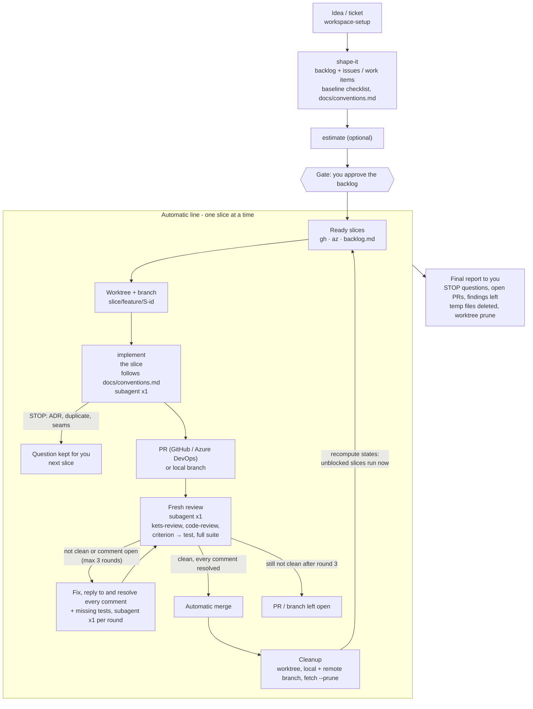

# Factory flow

How `factory` (`/kowalski:produci`) takes a shaped backlog to merged code, and where it uses subagents. The rules live in [`skills/development/factory/SKILL.md`](../skills/development/factory/SKILL.md); this page is the map.

## Mode, from the project setup

The first of these that answers: the `Provider:` line in `CLAUDE.md`, the `**Tracker:**` header of `scope.md`, the git remote.

| Mode | Slices come from | Done when | Merge |
| --- | --- | --- | --- |
| GitHub | the feature's issues (`gh`), from the `[Epic]` task list | issue closed | `gh pr merge`, PR body has `Closes #<issue>` |
| Azure DevOps | the Feature's child work items (`az`) | Done / Closed / Resolved | `az repos pr update --status completed --transition-work-items true` |
| Local | `backlog.md` (also the fallback for an unpublished feature) | `**Status:** done` | `git merge --no-ff`, only if the main checkout is on the default branch and clean |

A refused merge (branch protection, policies, conflicts) is never forced: the PR stays open and the report says why.

Review findings that are a pattern come back in the final report as rules to add to `docs/conventions.md`, which shape-it seeds before the first slice and implement and kets-review read.

## Subagents: how many and where

The session where you run `/kowalski:produci` is the orchestrator: it picks the slices, creates worktrees and PRs, merges and cleans up. The work on the code is done by subagents with a fresh context, one at a time, never in parallel.

| Step | Who does it | Subagents per slice |
| --- | --- | --- |
| States, worktree, spec file from the tracker | main session | 0 |
| Implement: tdd, spec check, `/simplify`, commit, screenshots when the UI changes (no review: 2d is the only one) | implement subagent | 1 |
| PR (short body: summary, criterion → test, tests changed, screenshots) or local branch | main session | 0 |
| Review: kets-review, code-review, each criterion → its test, no lost test cases, full suite | fresh subagent that never saw the code | 1 |
| Fix: every finding, code aligned with the ADRs, missing tests written, every review comment replied to and resolved | fix subagent, one per round | 0–3 |
| New review after each fix | a new subagent each time | 0–3 |
| Merge and cleanup | main session | 0 |
| **Total** | | **2–8** |

- Clean at the first review: 2 subagents. Three fix rounds: 8. A slice that stops: 1.
- Example: 5 ready slices use 10 to 40 subagents, in sequence.
- The skill doesn't pin a model: subagents use the session's model.
- Inside implement, the spec check starts an agent of its own where the environment allows it. A subagent usually can't start others; then it does the check itself and says so in its report.

## What comes back to you

Only the gate before the run is yours. After it you get the final report: merged slices, PRs left open and why, findings still open, `STOP` questions with their worktree, skipped slices. Worktrees and branches stay only when they hold unmerged work.
